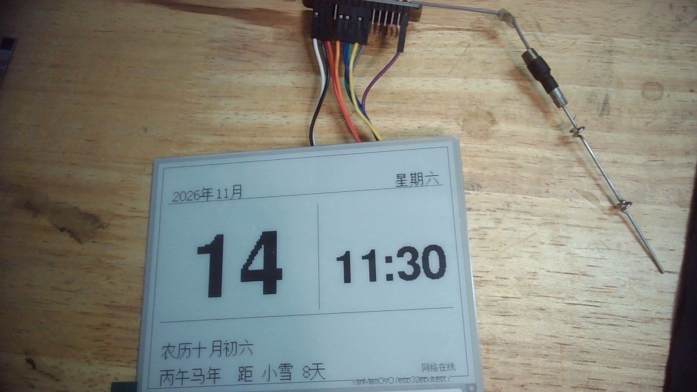
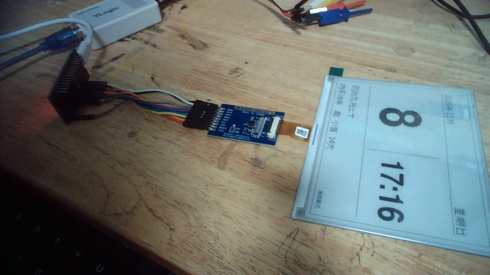

感谢Qwen和comate
已完成改造，`pio run` 编译通过（Flash 57.1%，748KB / 1.28MB；RAM 8.1%）。没有连接实机，所以显示效果未在屏幕上实测，但已按 648×480 做了布局预览。

## 新的日历界面

- 顶部：`2026年11月` + `星期日`
- 中部：超大号公历日期（FreeSansBold 24pt ×4）+ `HH:MM`
- 底部：`农历九月三十`、`丙午马年  距 小雪 14天`
- 右下角：`网络在线` / `正在对时` / `离线模式`

## 主要改动

- `src/main.cpp:296`：日历页面绘制
- `src/main.cpp:356`：WiFi 连接、NTP 对时、时区 `CST-8`
- `src/calendar_utils.h/.cpp`：公历转农历、干支生肖、星期、节气计算
- `src/solar_terms.h`：2000–2100 年二十四节气日期表
- `tools/gen_solar_terms.py`：节气表生成脚本（数据来自 lunar_python 天文算法）
- `include/config.h`：WiFi 和 NTP 配置
- [`platformio.ini`]()：新增 `U8g2_for_Adafruit_GFX`，用于显示中文

## 使用前必须做的一步

编辑 `include/config.h`，填入你的 2.4GHz WiFi：

```cpp
#define WIFI_SSID "你的WiFi名称"
#define WIFI_PASSWORD "你的WiFi密码"
```

不填也能运行，但会显示 `离线模式`，时间使用固件编译时间，会逐渐不准。

然后烧录：

```powershell
pio run -t upload
pio device monitor -b 115200
```

## 刷新策略

- 首次启动全屏刷新，清掉旧残影
- 之后只在分钟、日期或联网状态变化时刷新，避免每秒刷屏
- 电子墨水整屏刷新会闪一下，属于正常现象

如果你希望再增加月历网格、秒显示或天气，我可以继续扩展。

```task_complete
{"tasks":["kmto92","ugg832"]}
```

## 修复前的两次构建：

- `kmto92`：`fillRect` 缺少颜色参数，已修复
- `ugg832`：修复后构建成功

之后又做了一次增量构建（加入 `lastHour` 状态跟踪），同样 `SUCCESS`。当前代码状态正常，无需额外处理。
2026.11.14
已定位并修复。

**原因**

`getFontAscent()` 返回的是字库里的 `ascent_A`（wqy16 中只有 11px），并不是汉字实际的最大上伸高度。这个字库的真实包围盒是：

- `max_char_height = 18`
- `y_offset = -4`
- 实际基线以上高度 = `18 + (-4) = 14px`

旧代码用 11px 建立临时画布，导致顶部约 3px 被裁掉（你的字形正好少 2 行），底部也少了 1 行。

**修复**

`src/main.cpp:242` 起已改为：

- 用 `max_char_height + y_offset` 计算真实 ascent
- 用 `max_char_height` 作为画布高度
- 四周额外加 padding（左右 3px、上下 2px），同时避免字体负 x 偏移被裁

已重新编译通过：Flash 85.0%，RAM 13.8%。重新烧录即可。

串口启动时会打印一行用于确认：

```text
CJK font bounds: maxH=18 yOff=-4 ascent=14
```
**旧版本照片**

